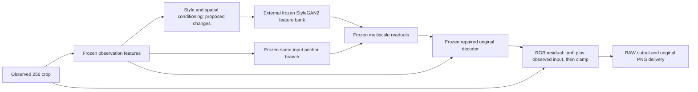

# Read-only reconstruction-path review — 14 October 2026

**The latest rejected experiment trained conditioning around a frozen decoder;
it did not add epochs to the original DGP.** Ten of its twenty TRAIN references
already use distinct HQ-derived FFHQ targets. Neither “all targets are enlarged
thumbnails” nor “we have already extended the original decoder repeatedly”
describes this experiment accurately. No new architecture, fourth training
recipe, threshold or app model was selected in this review.

[Source, tensor and target checks](<C:/xampp/htdocs/YEAR 4/Testing/outputs/cctv_dgp_frozen_reconstruction_path_review_v1/review.json>).
The review verifies 61 source/data/receipt fingerprints, with zero model
construction, neural forwards, gradient queries, parameter displacements,
optimizer updates or VM calls. Serialized tensors were loaded read-only.

## What the latest experiment could change

The returned protocol, worker's exact parameter selection, initial serialized
weights and VM environment receipt agree on the following partition:

| Path | Tensors / elements | Latest experiment |
|---|---:|---|
| Input-to-style and spatial conditioning | 12 / 2,580,864 | Three rejected finite proposals |
| Multiscale 1×1 feature readouts | 10 / 174,560 | Frozen |
| Repaired retained reconstruction decoder | 15 / 609,219 | Frozen |

The observation encoder, external pretrained StyleGAN2 bank, fixed recognition
model, normalization buffers and anchor branch also remain frozen. All twelve
initial conditioning arrays exactly match their serialized starting values.
The five readouts are nonzero and have full row rank in a saved-matrix check;
this excludes an all-zero readout explanation. Their rank does not prove useful
learning capacity, preservation or whole-face reconstruction quality.

The actual anchor projection is subtracted from the live projection before
reconstruction; it is a function of the same observed crop, not a clean target
or a same-person gallery. Initially they cancel exactly in the earlier audited
VM outputs. Feature additions enter scales 16/32/64, the 128 context and the
256 decoder feature map. The pretrained generator's RGB synthesis tail and 512
output are unused. The delivered face is produced by our retained residual
decoder, not by copying a pretrained restored face.

This makes the fixed decoder and fixed projection a legitimate design-review
subject. It does not prove either is the unique bottleneck. Earlier joint
decoder/bank training also failed; merely unfreezing these weights again would
repeat an unqualified idea unless a materially different finite design is
supported by the evidence.
[Earlier bank/decoder partition comparison](<C:/xampp/htdocs/YEAR 4/Testing/CCTV_DGP_BANK_PATH_ABLATION_V1_RESULTS.md>).

## Which targets actually guided these proposals

Only twenty already exposed TRAIN references, ten per source, contribute the
100 paired five-profile views. They do not represent all 781 references/3,905
TRAIN views, native CCTV or reserved final identities.

All twenty target images are exactly 256×256 and match the protocol's
**canonical_target_RGB_sha256** mapping and file bindings. For the ten FFHQ
references, each target differs from a direct bilinear enlargement of its
bound original 128×128 thumbnail. Those thumbnail enlargements reproduce the
old reference RGB hashes exactly. Their targets have declared HQ-counterpart
provenance; the original HQ source files were not reacquired or independently
reaudited in this small review.

The ten `asian_faces` source photographs are six 200×200 images plus four at
179×219, 153×195, 158×226 and 158×200. Their original bytes and dimensions were
checked. Resizing these to 256 supplies no new detail. Source labels do not
establish ethnicity, capture location or native CCTV performance. Differences
between source quality and targets must be reported separately; a blanket
target-resolution explanation would conceal the existing HQ comparison.
Useful target detail still needs visual assessment; pixel difference alone is
not a detail-quality score. The earlier twenty-sheet output review remains
the visual record, not an independent final human review.

The first read-only audit incorrectly treated an ancestral reference RGB hash
as the current target hash and stopped. The parent protocol explicitly marks
auxiliary reference metadata as ancestral. The authoritative canonical map
matches the actual HQ target, while the ancestral hash matches the reconstructed
thumbnail control. The failed review assertion is retained. No target, metadata,
hash tolerance or scientific gate was edited to obtain the passing check.
[Retained review-assumption failure](<C:/xampp/htdocs/YEAR 4/Testing/outputs/cctv_dgp_frozen_reconstruction_path_review_v1_attempt1.json>).

## What the results justify next

The latest finite proposals achieved at most 0.687495% RAW / 0.706917% PNG
structure gain and failed 32 preservation checks per stage. Zero changes were
accepted; rollback returned to the exact initial state in the retained VM
receipt. These trials added **zero accepted updates and zero epochs** to the
primary checkpoint. Changing derivative sampling did not establish a useful
preserving update in this conditioning-only path.

The permanent DGP checkpoint's recorded selected continuation is two extra
epochs / 226 updates. Its complete lifetime epoch count remains unconfirmed;
rejected experiments and the separate completion model's 19,000 updates cannot
be added to it. The permanent checkpoint is still
`646fbb11674e8882ea41e251d6e6e7d468c963979b48c93132def8292834e24b`.
Its DeblurGAN-v2-compatible architecture remains distinct from the external
frozen StyleGAN2 bank; neither name establishes an own-trained generative prior
or useful native CCTV performance.

The required design discussion is still pending after the joint, RAW-only and
nearby-gradient failures. This read-only inventory supplies evidence for that
discussion; it does not pick a fourth recipe or append epochs to a failed state.
[Pending question and unchanged gates](<C:/xampp/htdocs/YEAR 4/Testing/CCTV_DGP_POST_NEARBY_LEARNING_REVIEW_V1.md>).

All actual training, derivatives and learned or temporary neural parameter
changes remain human-manual on the L4 in tmux. All five milestones and seven
automatic/assisted covering families remain required, with native unpaired,
synthetic paired and untouched final evidence separate. Original checkpoint,
splits, caches, provenance, full states, failures and app design are preserved.
Useful model improvement, extended epochs and app promotion remain unqualified.
Goal incomplete.
